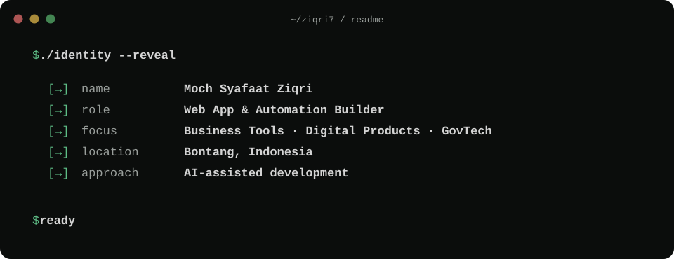

<picture>
  <source media="(max-width: 600px)" srcset="./assets/identity-mobile.svg">
  
</picture>

## Turning everyday workflows into working tools.

I'm Ziqri, based in Bontang, Indonesia. I build web applications and automation for the work that happens behind the scenes — bookings, administration, documents, and business operations.

My background spans creative work and public-sector operations. I use AI to support development, then check the result against the workflow it needs to serve.

### Selected work

| Work | What it helps with |
| --- | --- |
| **Clinic operations** · private | Patient records, invoicing, receipts, and day-to-day administration. |
| **Sports facility booking** · private | Scheduling, booking requests, and payment review workflows. |
| **[BuatPakeAI / PRDify](https://github.com/ziqri7/prdify)** | Turning product ideas into structured requirements through a guided questionnaire and AI-assisted drafting. |

### Tools I've used in these builds

JavaScript · TypeScript · React · Next.js · Node.js · Supabase · Google Apps Script · Google Workspace

### Let's connect

Have an operational workflow that needs a better tool? [Find me on LinkedIn →](https://id.linkedin.com/in/ziqri7)
